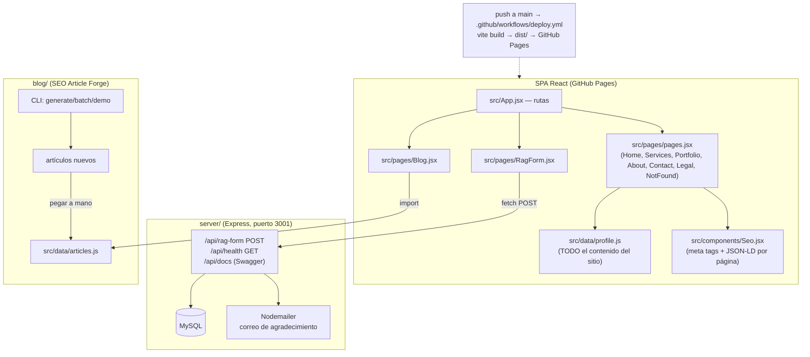

# CLAUDE.md

This file provides guidance to Claude Code (claude.ai/code) when working with code in this repository.

## Qué es este proyecto

Web personal de desarrollador freelance (**easyprodigital.com**) de Jesús Manuel Cristancho. Es un monorepo con cinco partes independientes, cada una con su propio `package.json` y `node_modules`:

1. **Raíz** — SPA en React 18 + Vite + React Router 7, desplegada en GitHub Pages.
2. **`server/`** — API Express (MySQL + Nodemailer + Swagger) para el formulario de descubrimiento (`/rag-form`). Corre aparte, NO se despliega en Pages.
3. **`blog/`** — "SEO Article Forge": generador CLI de artículos HTML estáticos con IA. Es una herramienta aparte: los artículos publicados viven en `src/data/articles.js` (`public/blog/` se eliminó).
4. **`showcase/`** — webs de muestra por nicho/prospecto (React + Vite + React Router), pensadas para enseñarle a un visitante cómo luciría la web de su negocio. Se despliega **aparte, en Dokploy**, bajo `demos.easyprodigital.com` — NO se despliega en Pages ni forma parte del build de la raíz. Cada demo vive en `showcase/src/demos/*.js` (contenido + tema) y se renderiza con `showcase/src/pages/DemoPage.jsx`. La página de Portafolio de la raíz enlaza a estas demos vía `nicheDemos` en `src/data/profile.js` / `profile.en.js`. Ver `showcase/README.md`.
5. **Rama `uchuva`** — sitio de producto del asistente de WhatsApp **Uchuva** (`uchuva.easyprodigital.com`): React + Vite con prerender propio, 4 páginas en español e inglés (Inicio, Cómo funciona, Panel, Precio y fundadores), SEO/GEO/AEO y `llms.txt`. Vive en su **propia rama** (no está en `react` ni en `main`; sus archivos están en la raíz de esa rama) y se despliega aparte en Dokploy (Dockerfile + nginx, autodeploy al hacer push a `uchuva`). Worktree local: `.wt-uchuva/`. La raíz solo enlaza a él desde el menú (`Layout.jsx`). Ver el `README.md` de esa rama.

## Arquitectura



Puntos clave del diseño:

- **Todo el contenido editable vive en `src/data/profile.js`** (servicios, proyectos, textos, contacto). Para cambiar contenido del sitio, casi siempre se edita ahí, no en los componentes.
- **`src/pages/pages.jsx` contiene varias páginas en un solo archivo** (Home, Services, Portfolio, About, Contact, Legal, NotFound). Solo `RagForm` y `Blog` tienen archivo propio.
- **El blog no tiene backend**: los artículos viven en `src/data/articles.js` (se prerenderizan a HTML estático) y sus títulos SEO en `src/data/articleSeo.js`. Tarjetas sociales por página: `npm run og` (genera `public/og/`).
- **Una página por servicio**: el contenido (EN/ES) vive en `src/data/servicePages.js` y se pinta con `NicheLanding` vía `ServiceLanding` en `pages.jsx`. Para agregar un servicio: slug en `SERVICE_SLUGS`, bloque en `en` y `es`, artículos de la columna derecha en `SERVICE_ARTICLES`, ruta en `App.jsx` (una línea `path="services/<slug>"`, el validador la lee con regex), entrada en `ROUTE_PATHS` de `scripts/prerender.mjs`, tarjeta en `scripts/generate-og.mjs` + `npm run og`, y URL en `public/sitemap.xml`.
- **Mercados**: EE. UU. y Canadá en inglés (`/`), Colombia en español (`/es/`). `Seo.jsx` emite hreflang `en-US`, `en-CA`, `es-CO`, `es-US` y `x-default`; el sitemap lleva los mismos códigos. `areaServed` en el JSON-LD es US, CA y CO.
- **SEO**: cada página usa el componente `Seo` (title/description/canonical/OG únicos + JSON-LD). Hay redirects de URLs del sitio anterior (`/plan`, `/sign_in`, `/log_in`) en `App.jsx` para conservar enlaces indexados. `sitemap.xml` y `robots.txt` en `public/`.
- **SPA en GitHub Pages**: el build copia `dist/index.html` a `dist/404.html` para que las rutas profundas no rompan al recargar en el navegador. Pero eso solo evita que el usuario vea un error — GitHub Pages sigue respondiendo con status HTTP 404 real para cualquier ruta sin archivo físico, y Google no indexa una página que responde 404 aunque el contenido se vea bien. Por eso `scripts/prerender.mjs` corre al final de `npm run build`: levanta el `dist/` ya compilado con `vite preview`, visita cada ruta real de `App.jsx` con Playwright/Chromium y guarda el HTML ya renderizado como `dist/<ruta>/index.html` (p. ej. `dist/services/index.html`, `dist/es/about/index.html`). Así cada URL del sitemap es un archivo estático real que GitHub Pages sirve con 200, con el `<title>`/canonical/meta description correctos, y el bundle de JS se sigue hidratando igual para la interactividad. **Si agregas una ruta nueva en `RouteChildren` (`src/App.jsx`), agrégala también a `ROUTE_PATHS` en `scripts/prerender.mjs`** o no se generará su versión estática. `public/CNAME` mantiene el dominio propio (`base: '/'` en `vite.config.js`).
- **Hidratación (velocidad, nov 2026)**: `src/main.jsx` usa `hydrateRoot` cuando `#root` ya trae HTML prerenderizado (no lo borra y vuelve a pintar). Para que el HTML guardado coincida con el primer render de React: el prerender abre cada ruta **con barra final**, con `reducedMotion: 'reduce'` y `window.__PRERENDER__ = true`; inserta `<!-- -->` entre textos seguidos, marca `<main>` con `<!--$-->…<!--/$-->` (el `<Suspense>` de `App.jsx`) y quita `is-visible` de los `Reveal` de scroll (`data-reveal="scroll"`). Reglas al tocar componentes: nada que dependa de la hora, `localStorage` o `Math.random` en el primer render (léelo en `useEffect`, como `ThemeToggle` y la hora del `StatusBar`); si un componente cambia el DOM al montar, que respete reduced-motion o `__PRERENDER__`. Errores React #418/#423/#425 en consola = HTML y React no coinciden.
- **Carga por partes**: `Article`, `Blog` y `RagForm` van con `React.lazy`. Los cuerpos de los artículos solo viajan con `Article`: el resto del sitio usa `src/data/articleIndex.js` (módulo virtual `virtual:articles-index` generado en `vite.config.js` desde `articles.js` sin `body`). Los scripts de Node siguen importando `articles.js`.
- **Fuentes y Analytics**: fuentes locales con `@fontsource` (`src/fonts.css`, solo latin); `gtag.js` se inyecta después del evento `load` (los eventos se encolan en `dataLayer`).
- **Primero lo que se ve**: `vite.config.js` precarga (`<link rel="preload">`) solo las fuentes de la primera pantalla (Archivo 900 y Instrument Sans 400). GSAP no va en el JS principal: `SplitText.jsx` lo descarga cuando el texto se acerca a la pantalla, y no re-anima un texto que ya está a la vista al cargar una página prerenderizada (`window.__EPD_PRERENDERED__` + `location.key === 'default'`). `LetterGlitch` arranca en pausa y solo dibuja mientras se ve.

## Comandos

### Frontend (raíz)

```bash
npm install
npm run dev        # Vite en http://localhost:5173
npm run dev:all    # frontend + backend juntos (scripts/run-dev.mjs, busca puerto libre desde 3001)
npm run build      # vite build → dist/ + copia dist/index.html a dist/404.html + prerender de cada ruta (scripts/prerender.mjs)
npm run preview
```

### Backend

```bash
cd server && npm install && npm start   # http://localhost:3001, Swagger en /api/docs
```

Configuración por variables de entorno: `DB_HOST/DB_PORT/DB_USER/DB_PASSWORD/DB_NAME` (MySQL, default `easyprodigital`) y `SMTP_HOST/SMTP_PORT/SMTP_USER/SMTP_PASS` (si no hay `SMTP_HOST`, no se envían correos pero la API funciona).

### Blog (generador de artículos)

```bash
npm run blog:demo      # genera artículos de demostración
npm run blog:generate  # genera un artículo
npm run blog:batch     # lote (ver blog/temas.example.txt y blog/config/default.js)
```

### Showcase (webs de muestra por nicho)

```bash
cd showcase && npm install && npm run dev   # http://localhost:5174
cd showcase && npm run build                # verificar antes de push
```

Se despliega en Dokploy (Dockerfile + nginx incluidos en `showcase/`), no en GitHub Pages. Ver `showcase/README.md` y `showcase/src/demos/README.md` para agregar una demo nueva.

No hay tests ni linter configurados.

## Deploy — ⚠️ regla crítica

El deploy a producción del **sitio principal** es **solo** vía `.github/workflows/deploy.yml`: push a `main` → `npm ci` → `npx playwright install --with-deps chromium` (necesario para el prerender SEO, ver arriba) → `npm run build` (raíz) → publica `dist/` en GitHub Pages (Settings → Pages → Source: **GitHub Actions**). Ese workflow solo construye la raíz del repo; no toca `server/`, `blog/` ni `showcase/`. El proyecto `showcase/` se despliega por separado en Dokploy (ver `showcase/README.md`) — un push a `main` no lo actualiza automáticamente salvo que Dokploy tenga su propio webhook configurado.

**Nunca agregar otro workflow que publique a Pages** (p. ej. el sample "Deploy Jekyll" que sugiere GitHub, o "deploy from branch"). En julio de 2026 un `jekyll-gh-pages.yml` agregado desde la UI compitió con `deploy.yml` y desplegó el código fuente sin compilar (`index.html` apuntando a `/src/main.jsx`), dejando el sitio en blanco. Si el sitio vuelve a quedar en blanco, verificar primero que `curl https://easyprodigital.com` devuelva un `index.html` con `/assets/index-*.js` (build real) y no `/src/main.jsx` (fuente sin compilar).

El trabajo se hace en la rama `react` y se integra a `main` por PR/merge; el push a `main` es lo que dispara el deploy.
